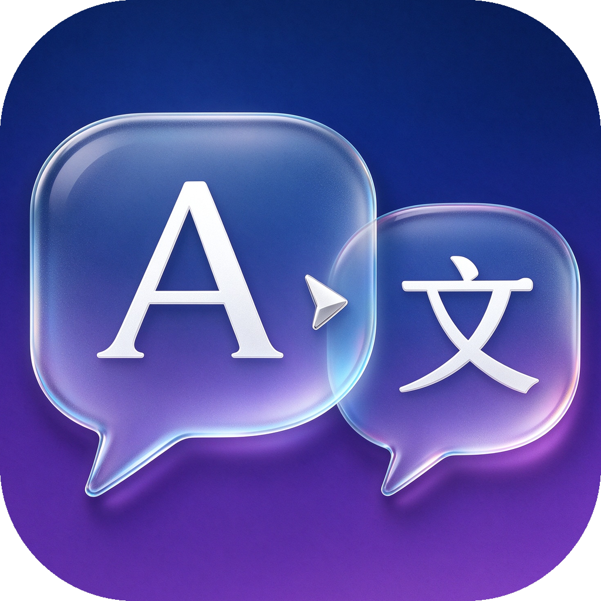

<div align="center">



# QTranslate

**A lightweight select-to-translate app for Windows 10/11.**

[](https://github.com/Mine1178/QTranslate/releases/latest)
[](https://github.com/Mine1178/QTranslate/releases/latest)
[](https://github.com/Mine1178/QTranslate/releases/latest)
[](./LICENSE)

[**⬇️ Download for Windows**](https://github.com/Mine1178/QTranslate/releases/latest) · [简体中文](README.md)


</div>

## Why QTranslate?

Most Windows translation tools are either browser extensions, web apps, or 100 MB+ suites packed with features you never use.

QTranslate keeps only the parts you use every day: **select text → get a translation**, plus reading aloud and a local vocabulary book. It starts fast, sits quietly in the tray, and the installer is about 20 MB.

| | QTranslate | Typical translator suite |
| --- | --- | --- |
| Startup | Instant | 3–5 seconds |
| Memory | ~50–80 MB idle | 200–500 MB |
| Installer | ~20 MB | 100+ MB |
| Scope | Translation only | OCR, screenshots, ads, extras |

## Features

- **Select-to-translate** — select foreign text and the translation popup appears
- **Input translation** — `Ctrl + Enter` opens a manual translation window
- **Multiple engines** — Baidu, DeepL, Google, OpenAI, Microsoft, Youdao
- **Read aloud** — Edge TTS with multiple voices
- **Vocabulary book** — save, search and review words locally
- **History** — keep previous translations and re-run them
- **Themes** — light, dark, or follow the system
- **Global hotkeys** — customize shortcuts
- **Plugin support** — extend with `.spkg` plugins
- **English / Chinese UI** — follows the system language

## Install

Download the latest [Release](https://github.com/Mine1178/QTranslate/releases/latest):

- **`Setup.exe`** — recommended; includes the runtime, creates a desktop shortcut
- **`Portable.zip`** — no install; requires the .NET 10 Desktop Runtime

After launch, the app stays in the system tray. Select foreign text in any app; the translation window appears.

## Default hotkeys

| Shortcut | Action |
| --- | --- |
| `Ctrl + Enter` | Open input translation |
| `Ctrl + Shift + Q` | Show / hide the main window |

Both can be changed in **Settings → Hotkeys**.

## Privacy

- No account is required.
- Vocabulary, history and settings are stored locally in `%AppData%\STranslate\`.
- Text is sent only to the translation engine you enable (Google, DeepL, OpenAI, etc.). If you need fully offline translation, use a local engine/plugin.

## Build from source

```powershell
git clone https://github.com/Mine1178/QTranslate.git
cd QTranslate/src
dotnet build STranslate/STranslate.csproj -c Release
```

## License

MIT. Based on [STranslate](https://github.com/STranslate/STranslate) by zggsong; modifications © 2026 Mine1178.

---

If QTranslate saves you a few clicks, a ⭐ on GitHub is the simplest way to support it.
