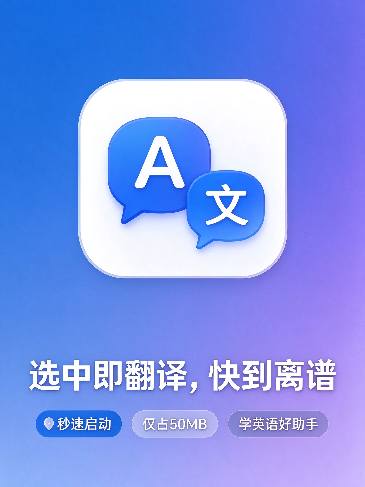
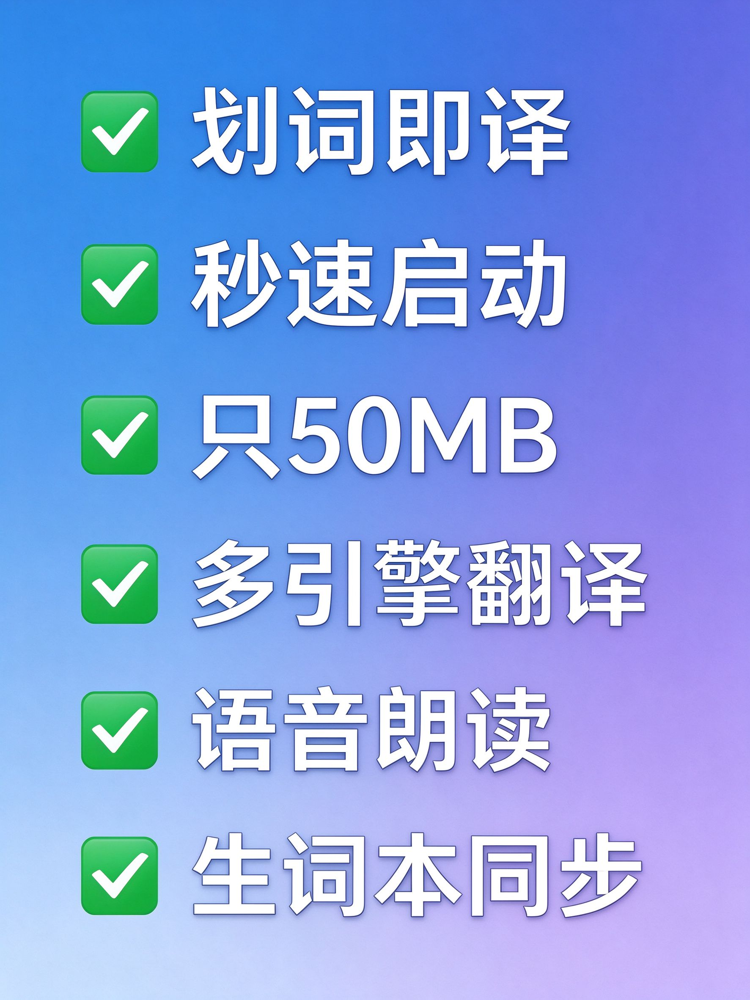

<div align="center">


# QTranslate

**⚡ 极致轻量的 Windows 桌面划词翻译工具**

[](https://github.com/Mine1178/QTranslate/releases/latest)
[](https://github.com/Mine1178/QTranslate/releases/latest)
[](https://github.com/Mine1178/QTranslate/releases/latest)
[](./LICENSE)
[](https://github.com/Mine1178/QTranslate/releases/latest)

<p align="center">
  划词即译 · 秒速启动 · 常驻托盘 · 多引擎聚合 · TTS 朗读 · 生词本
</p>

</div>

---

## 📖 目录

- [✨ 为什么选择 QTranslate](#-为什么选择-qtranslate)
- [📸 界面预览](#-界面预览)
- [🎯 核心功能](#-核心功能)
- [💻 兼容性与环境](#-兼容性与环境)
- [🚀 快速开始](#-快速开始)
- [⌨️ 默认快捷键](#️-默认快捷键)
- [❓ 常见问题](#-常见问题)
- [🛠 从源码构建](#-从源码构建)
- [💝 支持本项目](#-支持本项目)
- [📄 License](#-license)

---

## ✨ 为什么选择 QTranslate？

| | **QTranslate** | 传统翻译工具 |
|---|---|---|
| 🚀 **启动速度** | 秒开，无等待 | 3-5 秒启动 |
| 💾 **内存占用** | 常驻约 50–80 MB，空闲 CPU ≈ 0 | 200-500 MB |
| 📦 **安装包** | 约 20 MB | 100+ MB |
| 🎯 **专注度** | 只做翻译，不臃肿 | 塞满用不上的功能 |
| 🎨 **界面** | 现代 Fluent 设计，浅色 / 深色 / 跟随系统 | 老旧 Windows 风格 |

> **砍掉 OCR、砍掉截图翻译、砍掉冗余功能**——只留你每天都在用的划词翻译、输入翻译、朗读与生词本。

---

## 📸 界面预览

<div align="center">





</div>

---

## 🎯 核心功能

<div align="center">

| | | |
|:---:|:---:|:---:|
| 🔤 **划词翻译**<br/>选中即译 | ⌨️ **输入翻译**<br/>手动输入即译 | 🌐 **多引擎**<br/>百度 / DeepL / Google / OpenAI / 微软 / 有道 |
| 🔊 **TTS 朗读**<br/>Edge 语音多语种 | 📖 **生词本**<br/>收藏、搜索、删除 | 🕐 **历史记录**<br/>自动留存可重译 |
| 🎨 **多主题**<br/>浅色 / 深色 / 跟随系统 | ⌨️ **快捷键**<br/>全局自定义 | 🧩 **插件系统**<br/>.spkg 扩展 |

</div>

---

## 💻 兼容性与环境

- **操作系统**：Windows 10 / 11（x64）
- **安装版**：自带运行时，双击安装即可使用
- **便携版**：需要系统已安装 .NET 10 桌面运行时；未安装时启动弹窗引导，可通过 winget 自动下载
- **配置目录**：`%AppData%\STranslate\`，支持 `.BACKUP` 备份与恢复，可接入 WebDAV 云同步
- **界面语言**：跟随系统，支持简体中文与英文

---

## 🚀 快速开始

### 下载

前往 [Releases](https://github.com/Mine1178/QTranslate/releases/latest) 下载最新版：

| 版本 | 适用场景 |
|---|---|
| **Setup.exe 安装包** ⭐ | 推荐，双击安装，自动创建桌面快捷方式，自带运行时 |
| 便携版（Portable.zip） | 绿色免安装，解压即用；需 .NET 10 桌面运行时 |

### 三步上手

1. **安装 / 解压**
2. 启动后软件安静躺在系统托盘 🔔
3. 选中任意外文 → 自动弹出翻译结果；按 `Ctrl + Enter` 呼出输入翻译窗口

> 首次进入「设置 → 翻译设置」即可启用所需引擎并填入对应 API Key；Google、微软等内置接口无需密钥。

---

## ⌨️ 默认快捷键

| 快捷键 | 功能 |
|---|---|
| `Ctrl + Enter` | 呼出输入翻译窗口 |
| `Ctrl + Shift + Q` | 显示 / 隐藏主界面 |

> 全部可在「设置 → 快捷键」中自定义。

---

## ❓ 常见问题

**Q：启动后看不到窗口？**
A：软件默认隐藏在系统托盘。查看屏幕右下角托盘区，左键单击 QTranslate 图标即可呼出主窗口。

**Q：划词翻译不弹窗？**
A：检查「设置 → 翻译设置」中划词翻译是否启用；确认快捷键没有被其他软件占用。

**Q：翻译失败 / 报错？**
A：先检查网络连接；确认对应翻译引擎的 API Key 已正确填写；也可以切换其他引擎试试。

**Q：提示缺少 .NET 运行时？**
A：便携版需要 .NET 10 桌面运行时；弹窗中点「是」会自动通过 winget 下载安装，或直接改用 Setup 安装包。

**Q：如何切换中英文界面？**
A：界面跟随系统语言，目前支持简体中文和英文。

**Q：软件占用资源高吗？**
A：常驻内存约 50–80 MB，空闲时 CPU 占用接近 0。

---

## 🛠 从源码构建

```bash
git clone https://github.com/Mine1178/QTranslate.git
cd QTranslate/src
dotnet build STranslate/STranslate.csproj -c Release
```

---

## 💝 支持本项目

如果 QTranslate 帮到了你，可以请作者喝杯咖啡 ☕ 你的支持是持续开发的动力 ❤️

<div align="center">
  
  
</div>

---

## 📄 License

[MIT](./LICENSE) · Based on [STranslate](https://github.com/STranslate/STranslate) by zggsong · 二次开发版权归 Mine1178 所有
